# Diagrama de fluxo de usuario do aplicativo

Formato: Markdown com blocos Mermaid.

Este documento mapeia os caminhos principais do usuario a partir dos pontos clicaveis do app: cards, botoes de hub, abas, footer global, scanner, relatorios, emergencia, viagem, menu e fluxos derivados.

Escopo analisado no codigo:

- `App.js`
- `navigation/MainTabNavigator.js`
- `components/GlobalFloatingFooter.js`
- `screens/HomeScreenNeo.js`
- `screens/Education/KnowledgeHubScreen.js`
- `screens/Travel/TravelModeScreen.js`
- `screens/MenuScreenNeo.js`
- `screens/InfoRotulosScreen.js`
- `screens/ScannerScreen.js`
- `screens/InfoRotulosResultScreen.js`
- `screens/Checklists/RelatoriosScreenNeo.js`
- `screens/Checklists/OndeProtegerScreen.js`
- `screens/Checklists/ChecklistWizardScreen.js`
- `screens/ModoPreventivoScreenNeo.js`
- `screens/Tools/FerramentasIAScreenNeo.js`
- `screens/Pets/PetsMenuScreen.js`
- `screens/Health/MinhaSaudeScreen.js`

Convencoes:

- Ponto inicial: app aberto.
- Ponto final: tela de resultado, relatorio, checklist concluido, item salvo, chamada externa, email, mapa externo ou retorno para `MainTabs`.
- Setas com texto indicam acao do usuario ou condicao do app.
- Rotas alternativas e erros aparecem como decisoes.

## 1. Entrada do app e navegacao global

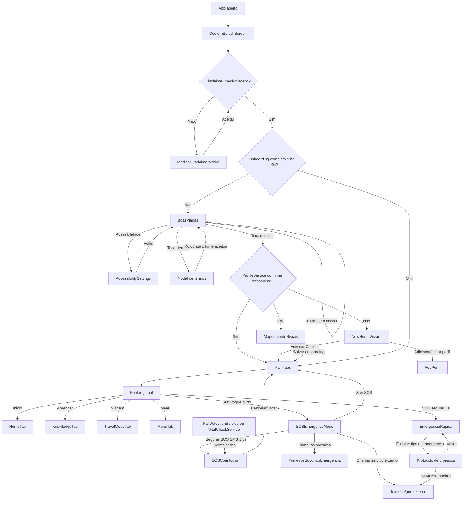

## 2. Home: cards, decisoes e pontos finais

```mermaid
flowchart TD
    H["HomeTab / HomeScreenNeo"] --> A["Seletor de moradia"]
    A --> A1["Modal Minhas residencias"]
    A1 -- "Escolher residencia" --> H
    A1 -- "Cadastrar nova moradia" --> A2{"Nome informado?"}
    A2 -- "Nao" --> A1
    A2 -- "Sim" --> A3["Moradia criada"]
    A3 -- "Depois" --> H
    A3 -- "Configurar agora" --> MAP["OndeProteger"]

    H --> B["Card do perfil"]
    B --> BP["QuemProteger"]
    BP -- "Sem pessoa central" --> BP1["AddPerfil humano"]
    BP -- "Perfil incompleto" --> BP2["AddPerfil com perfil"]
    BP -- "Pessoa cadastrada" --> BP3["Seleciona perfil central"]
    BP -- "Ver leitura personalizada" --> BP4["ProfileRiskSummary"]
    BP -- "Raio-X da casa" --> BP5["HomeXRay"]
    BP -- "Refazer onboarding da casa" --> BP6["NewHomeWizard"]
    BP -- "Continuar" --> MT["MainTabs"]

    H --> C{"Hero principal: estado do app"}
    C -- "Sem conexao" --> C1["Primario: Relatorios"]
    C -- "Sem conexao" --> C2["Secundario: QuemProteger"]
    C -- "Bateria critica" --> C3["Relatorios ou ModoPreventivo"]
    C -- "Sem briefing" --> C4["OndeProteger ou QuemProteger"]
    C -- "Mapeamento em andamento" --> C5["Proxima etapa do briefing ou Relatorios"]
    C -- "Medicacao vencida" --> C6["MedicationScheduler ou MinhaSaude"]
    C -- "Score alto" --> C7["Relatorios ou QuemProteger"]
    C -- "Score medio" --> C8["Relatorios ou ModoPreventivo"]
    C -- "Score baixo" --> C9["SafetyActionPlan ou QuemProteger"]

    H --> D["Grid Acesso rapido"]
    D -- "Briefing vivo" --> MAP
    D -- "Plano de cuidado" --> RPT["Relatorios"]
    D -- "Tarefa eventual" --> EVT["AddEvent"]
    D -- "Scanner com contexto" --> IR["InfoRotulos"]

    EVT --> EVT1{"Tipo de evento"}
    EVT1 -- "Tratamento continuo" --> EVT2["AddTreatment"]
    EVT1 -- "Consulta" --> EVT3["AddAppointment"]
    EVT1 -- "Exame" --> EVT4["AddExam"]
    EVT1 -- "Procedimento" --> EVT5["AddProcedure"]
    EVT2 --> EVTF["Salvar ou voltar"]
    EVT3 --> EVTF
    EVT4 --> EVTF
    EVT5 --> EVTF

    H --> E["Card Briefing vivo"]
    E --> MAP

    H --> F{"Orientacao diaria"}
    F -- "Saude pendente" --> C6
    F -- "Briefing ausente" --> MAP
    F -- "Pendencias no plano" --> PLAN["SafetyActionPlan"]
    F -- "Ha pets" --> PETS["PetsMenu"]
    F -- "Sem pendencia critica" --> RPT

    H --> G{"Acoes acompanhaveis"}
    G -- "Mapeamento incompleto" --> MAP
    G -- "Pendencias" --> PLAN
    G -- "Saude pendente" --> C6
    G -- "Avulsa" --> EVT

    H --> I["Monitor da casa"]
    I -- "Expandir/recolher" --> H
    I -- "Status muda" --> C

    H --> J["Ferramentas inteligentes"]
    J -- "Vigilaro IA" --> CHAT["AITextChat"]
    J -- "Centro de IA" --> TOOLS["FerramentasIA"]
```

## 3. Fluxo de mapeamento, checklists e relatorios

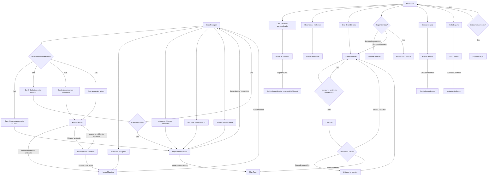

## 4. InfoRotulos, scanner e resultado

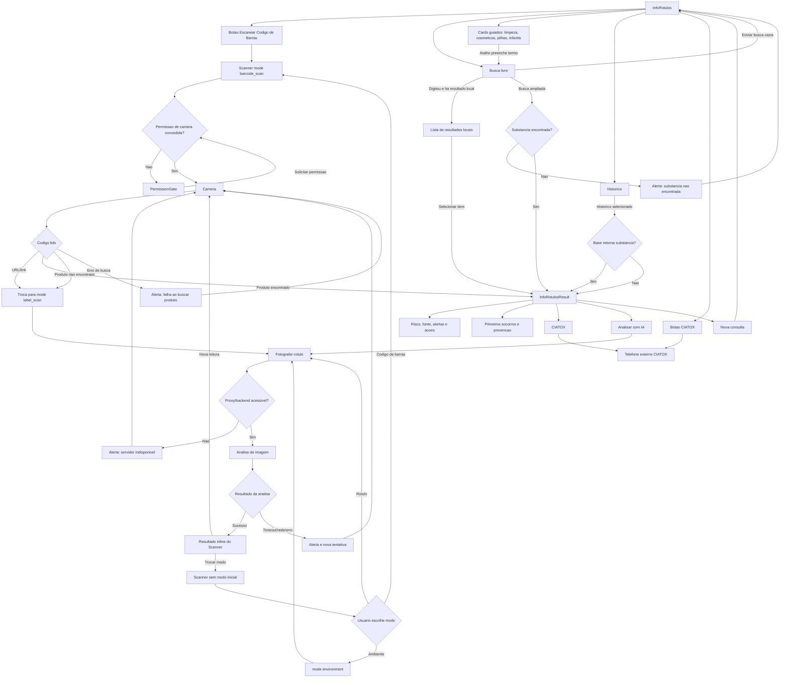

## 5. Ferramentas IA

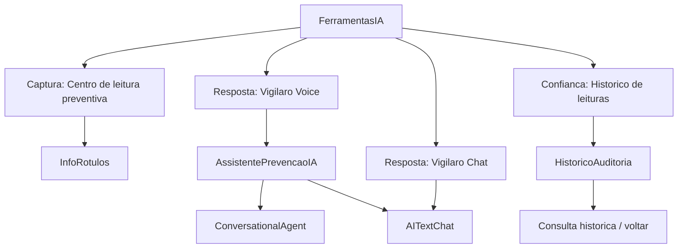

## 6. Aprender: trilhas e cards

```mermaid
flowchart TD
    KH["KnowledgeTab / KnowledgeHub"] --> H1["Hero: Micro Blog"]
    H1 --> MB["MicroBlog"]
    MB -- "Seleciona artigo" --> MA["MicroArticle"]
    KH --> H2["Hero: Radar Vigilaro"]
    H2 --> RV["RadarVigilaro"]
    RV -- "Seleciona caso/artigo" --> RA["RadarArticle"]

    KH --> S1["Destaque: Metodologia"]
    S1 --> ISM["IntroSafetyMenu"]
    ISM -- "Seleciona conceito" --> CD["ConceitoDetail"]
    KH --> S2["Destaque: Primeiros Socorros"]
    S2 --> PS["PrimeirosSocorros"]
    KH --> S3["Destaque: Pets"]
    S3 --> PETS["PetsMenu"]

    KH --> F["Fundacao: Metodologia"]
    F --> ISM

    KH --> C["Contextos"]
    C -- "Ambientes" --> EE["EducationEnvironments"]
    EE -- "Seleciona ambiente" --> EGN["EnvironmentGuideNeo"]
    EGN -- "Checklist do ambiente" --> AI["AreasInternas"]
    EGN -- "Inventario" --> HM["HazardMapping"]
    C -- "Pets" --> PETS
    C -- "Seguranca por idade" --> FVM["FasesVidaMenu"]
    FVM -- "Seleciona fase" --> CD
    C -- "Gestante segura" --> GC1["GenericCategory gestante_segura"]
    C -- "Guia de brinquedos" --> GC2["GenericCategory brinquedos"]
    GC1 -- "Seleciona conteudo" --> CD
    GC2 -- "Seleciona conteudo" --> CD

    KH --> R["Analises"]
    R -- "Utensilios" --> UR["UtensiliosReviews"]
    R -- "Eletrodomesticos" --> ER["EletrodomesticosReviews"]
    R -- "Dispositivos eletronicos" --> DR["DispositivosEletronicosReviews"]
    UR -- "Seleciona item" --> SRD["SafetyReviewDetail"]
    ER -- "Seleciona item" --> SRD
    DR -- "Seleciona item" --> SRD

    KH --> EM["Emergencias"]
    EM -- "Prevencao incendio" --> GCF["GenericCategory fire_prevention"]
    EM -- "Planos de fuga" --> PI["PlanoIncendio"]
    EM -- "Primeiros socorros" --> PS
    EM -- "Guia de kits" --> GKE["GuiaKitsEmergencia"]
    GKE -- "Abrir conteudo" --> CD
    GKE -- "Montar este kit" --> KM["KitsMenu"]
    KM -- "Seleciona checklist de kit" --> CKD["ChecklistDetail"]

    KH --> G["Guias praticos"]
    G -- "Plantas toxicas" --> PT["PlantasToxicas"]
    G -- "Animais peconhentos" --> AP["AnimaisPeconhentos"]
    G -- "Produtos perigosos" --> PP["ProdutosPerigosos"]
    G -- "Riscos fisicos" --> RF["RiscosFisicos"]
    G -- "Jardinagem segura" --> JS["JardinagemSegura"]
    G -- "Condominio" --> GCC["GenericCategory condominio_seguranca"]
    PT -- "Seleciona planta" --> CD
    AP -- "Seleciona animal" --> CD
    PP -- "Seleciona produto" --> CD
    RF -- "Seleciona risco" --> CD
    GCC -- "Seleciona conteudo" --> CD

    KH --> M["Mobilidade"]
    M -- "Lazer e ferias" --> LFM["LazerFeriasMenu"]
    LFM -- "Lazer" --> SL["SegurancaLazer"]
    LFM -- "Ferias" --> SF["SegurancaFerias"]
    LFM -- "Mobilidade" --> MS["MobilidadeSegura"]
    M -- "EPIs e ferramentas" --> FT["FerramentasTrabalho"]
    FT -- "EPI domestico" --> EPI["EpiDomestico"]
    FT -- "Acessorios de seguranca" --> ACS["AcessoriosSeguranca"]
```

## 7. Pets

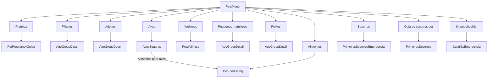

## 8. Viagem

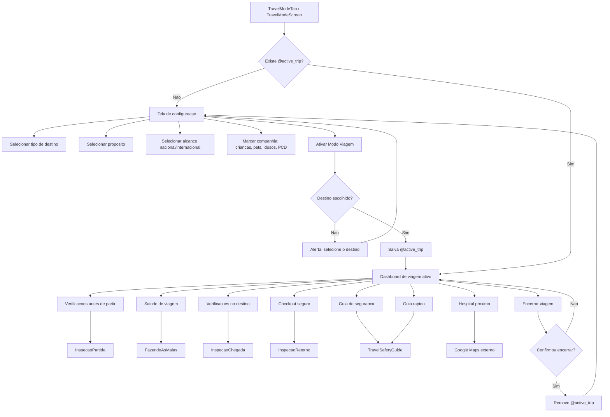

## 9. Menu, configuracoes e suporte

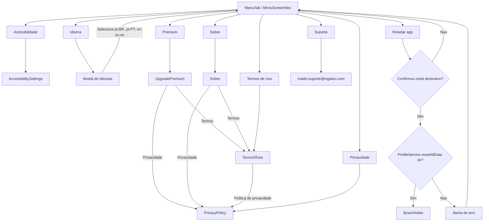

## 10. Modo preventivo

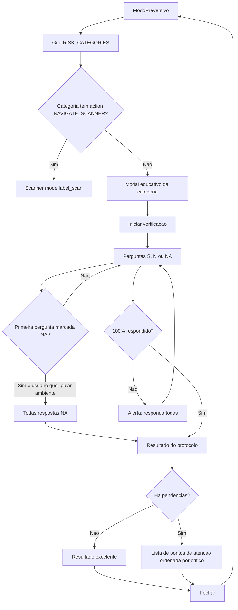

## 11. Minha Saude e agenda

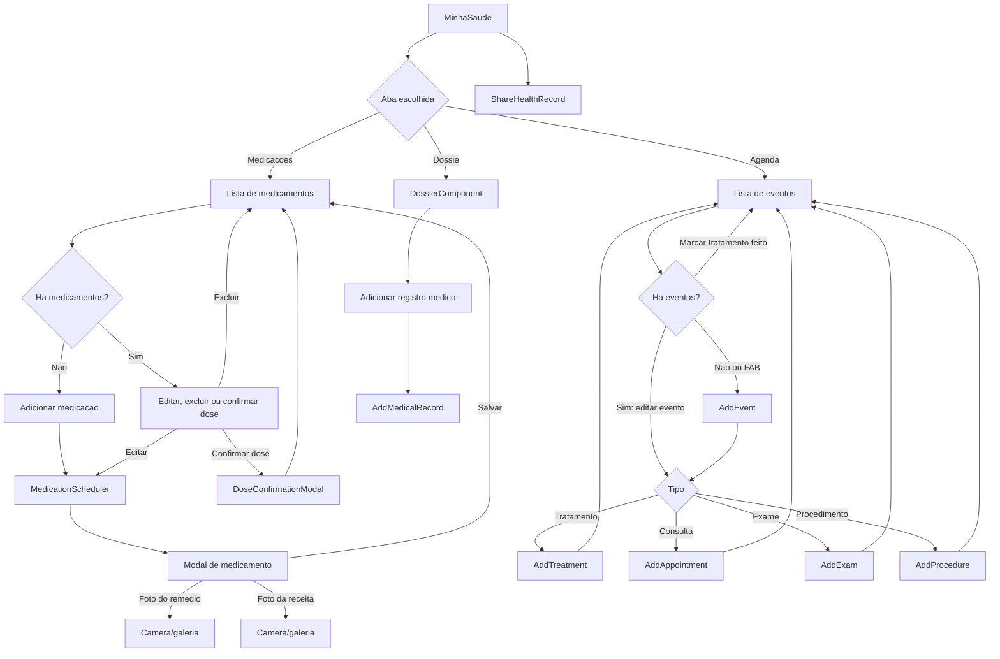

## Observacoes de rota

- `KitsHub` possui cards `KitFerramentas` e `KitEPIs`, mas estas rotas nao aparecem declaradas em `App.js`. Se o usuario chegar a `KitsHub` e tocar nesses cards, ha risco de erro de navegacao.
- `MainTabNavigator` declara `AcessibilidadeTab`, mas o footer global nao mostra essa aba diretamente. O acesso visivel fica principalmente pelo Menu e pela tela de boas-vindas.
- `Scanner` em `label_scan` ou `environment` mostra resultado inline dentro do proprio scanner. O resultado `InfoRotulosResult` e usado principalmente para busca, historico e codigo de barras resolvido.
- O footer global e ocultado em rotas de onboarding, camera, IA conversacional, SOS, situacao ativa e premium. Nesses pontos o retorno depende dos botoes internos de cada tela.
